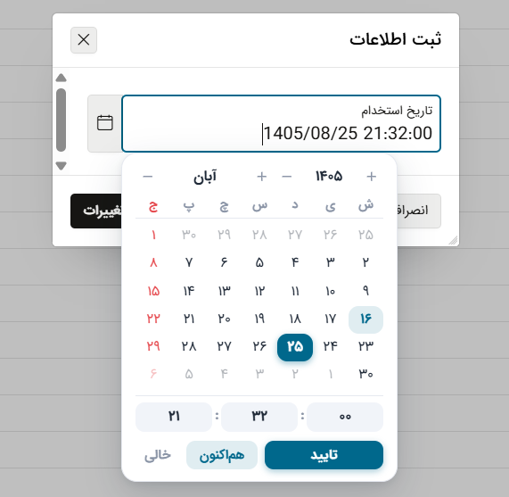
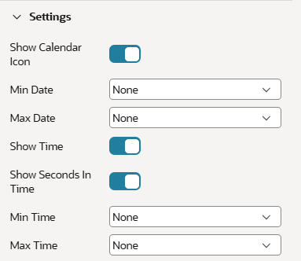
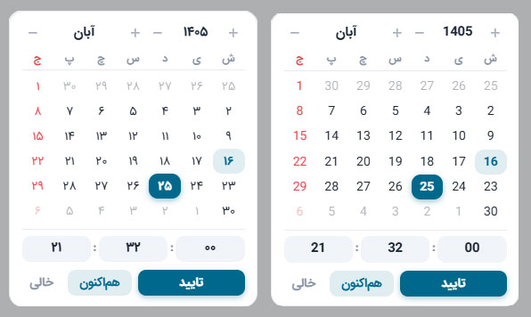
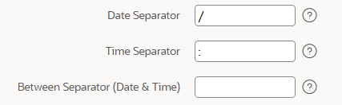
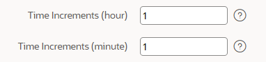
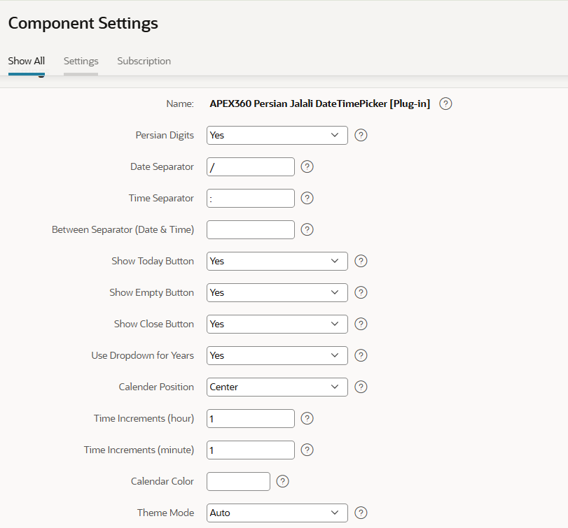

# 📅 پلاگین تقویم جلالی Oracle APEX | Persian Date Picker
<p align="center"></p>

# پلاگین تقویم شمسی و انتخاب تاریخ و زمان APEX360 برای Oracle APEX

### Persian Jalali Date Picker & DateTime Picker Plugin for Oracle APEX

**APEX360 Persian Jalali DateTimePicker** یک پلاگین کاربردی و قابل تنظیم برای Oracle APEX است که امکان انتخاب تاریخ شمسی (Jalali) و زمان را در محیط برنامه‌های مبتنی بر Oracle APEX فراهم می‌کند.

این پلاگین به‌صورت یک **Item Type Plugin** طراحی شده و امکاناتی مانند انتخاب تاریخ و ساعت، محدودیت حداقل و حداکثر تاریخ و زمان، نمایش ارقام فارسی و انگلیسی، شخصی‌سازی ظاهر تقویم و سازگاری با صفحات Modal را در اختیار توسعه‌دهندگان قرار می‌دهد.

اگر به دنبال یک پلاگین **تقویم شمسی برای Oracle APEX**، انتخابگر تاریخ جلالی یا **Persian DateTimePicker** هستید، این پلاگین می‌تواند راهکاری مناسب برای استفاده در برنامه‌های سازمانی و تجاری شما باشد.

---

## ✨ امکانات و قابلیت‌ها

### ۱. تقویم شمسی (Persian Jalali Date Picker)

امکان انتخاب تاریخ با استفاده از تقویم هجری شمسی در برنامه‌های Oracle APEX.

قابلیت‌ها:

- نمایش و انتخاب تاریخ شمسی (Jalali Calendar)
- پشتیبانی از انتخاب تاریخ و زمان
- پشتیبانی از ارقام فارسی و انگلیسی
- امکان تنظیم جداکننده‌های تاریخ و زمان

### ۲. سازگاری با صفحات Modal در Oracle APEX

یکی از مشکلات رایج در استفاده از Date Pickerها در صفحات Modal اوراکل APEX، محدود شدن نمایش تقویم توسط محدوده محتوایی پنجره Modal است. در این شرایط ممکن است بخشی از تقویم مخفی شود یا به‌درستی نمایش داده نشود.

در این پلاگین، مکانیزمی برای نمایش تقویم خارج از محدوده محدودکننده Modal در نظر گرفته شده است تا از بریده شدن یا مخفی شدن بخش‌هایی از تقویم جلوگیری شود.



### ۳. انتخاب تاریخ و زمان (Date & Time Picker)

پلاگین از حالت‌های مختلف انتخاب تاریخ و زمان پشتیبانی می‌کند:

- انتخاب تاریخ (Date)
- انتخاب ساعت (Time)
- انتخاب هم‌زمان تاریخ و ساعت (DateTime)
- انتخاب ساعت و دقیقه
- امکان فعال یا غیرفعال کردن ثانیه‌ها

توسعه‌دهندگان می‌توانند با توجه به نیاز برنامه، حالت موردنظر را پیکربندی کنند.



### ۴. تعیین حداقل و حداکثر تاریخ و زمان

با استفاده از این قابلیت می‌توانید محدوده مجاز انتخاب تاریخ و زمان را مشخص کنید.

محدودیت‌های قابل تنظیم:

| تنظیمات | توضیحات |
|---|---|
| Minimum Date | تعیین کمترین تاریخ مجاز |
| Maximum Date | تعیین بیشترین تاریخ مجاز |
| Minimum Time | تعیین کمترین زمان مجاز |
| Maximum Time | تعیین بیشترین زمان مجاز |

مقادیر محدودیت‌ها می‌توانند به دو روش تعیین شوند:

- مقدار ثابت (Static Value)
- دریافت مقدار از سایر Page Itemهای اوراکل APEX

این قابلیت برای سیستم‌های رزرو، نوبت‌دهی، زمان‌بندی فعالیت‌ها و فرم‌های سازمانی بسیار کاربردی است.

### ۵. شخصی‌سازی رنگ و پشتیبانی از Dark Mode

امکان تغییر ظاهر تقویم و هماهنگ‌سازی آن با طراحی برنامه Oracle APEX وجود دارد.

حالت‌های نمایشی:

- **Light Mode:** نمایش تقویم با تم روشن
- **Dark Mode:** نمایش تقویم با تم تیره
- **Auto:** انتخاب خودکار تم متناسب با محیط

همچنین امکان شخصی‌سازی رنگ اصلی تقویم وجود دارد.


### ۶. پشتیبانی از ارقام فارسی و انگلیسی

امکان انتخاب نوع نمایش ارقام در تقویم و مقادیر عددی وجود دارد:

- ارقام فارسی
- ارقام انگلیسی

این قابلیت به توسعه‌دهندگان اجازه می‌دهد نمایش اطلاعات را متناسب با زبان و استانداردهای رابط کاربری برنامه تنظیم کنند.



### ۷. تنظیم جداکننده تاریخ و زمان

امکان شخصی‌سازی کاراکترهای جداکننده در مقادیر تاریخ و زمان وجود دارد.

تنظیمات قابل تغییر:

- جداکننده تاریخ (Date Separator)
- جداکننده زمان (Time Separator)
- جداکننده تاریخ و زمان (DateTime Separator)



### ۸. تنظیم بازه‌های زمانی (Time Increments)

با استفاده از این قابلیت می‌توانید فاصله زمانی بین گزینه‌های قابل انتخاب ساعت و دقیقه را مشخص کنید.

برای مثال، بازه انتخاب دقیقه می‌تواند شامل مقادیر زیر باشد:

- هر ۵ دقیقه
- هر ۱۰ دقیقه
- هر ۱۵ دقیقه

این قابلیت در سیستم‌های رزرو، نوبت‌دهی و زمان‌بندی فعالیت‌ها کاربرد دارد.



### ۹. رابط کاربری سازگار با موبایل (Responsive)

رابط کاربری پلاگین برای نمایش در صفحه‌نمایش‌های کوچک و دستگاه‌های موبایل بهینه شده است تا کاربران بتوانند به‌راحتی از امکانات انتخاب تاریخ و زمان استفاده کنند.

### ۱۰. سایر تنظیمات تقویم

امکانات تکمیلی برای کنترل رفتار و نحوه نمایش تقویم:

- نمایش یا مخفی کردن آیکون تقویم
- نمایش دکمه امروز (Today)
- نمایش دکمه پاک کردن مقدار (Empty)
- نمایش دکمه بستن (Close)
- فعال‌سازی انتخاب سال از طریق لیست کشویی
- تنظیم موقعیت نمایش تقویم (Calendar Position)

---

## 🖥️ سازگاری با نسخه‌های Oracle APEX

این پلاگین از نسخه‌های زیر پشتیبانی می‌کند:

| نسخه Oracle APEX | وضعیت پشتیبانی |
|---|---|
| 22.1 | پشتیبانی می‌شود |
| 22.2 | پشتیبانی می‌شود |
| 23.x | پشتیبانی می‌شود |
| 24.x | پشتیبانی می‌شود |
| 26.x | پشتیبانی می‌شود |

**کامپوننت‌های پشتیبانی‌شده:**

- Page Items
- Interactive Grid Columns

**حداقل نسخه موردنیاز Oracle APEX:** نسخه 22.1

---

## 📦 راهنمای نصب (Installation)

نصب پلاگین بسیار ساده است و از طریق محیط استاندارد Oracle APEX انجام می‌شود.

### مرحله اول: دریافت فایل پلاگین

فایل SQL نصب پلاگین را از لینک زیر دریافت کنید:

[دانلود پلاگین APEX360 Persian Jalali DateTimePicker](images/item_type_plugin_ir_apex360_datetimepicker_apex.sql)

### مرحله دوم: وارد کردن پلاگین در Oracle APEX

وارد محیط توسعه Oracle APEX شده و مسیر زیر را دنبال کنید:

`Shared Components → Plug-ins → Import`

فایل SQL دانلودشده را انتخاب کرده و مراحل Import را تکمیل کنید.

### مرحله سوم: تنظیمات عمومی پلاگین

پس از نصب، به مسیر زیر مراجعه کنید:

`Shared Components → Component Settings`

در این بخش می‌توانید تنظیمات عمومی و سطح Application پلاگین را مشاهده و پیکربندی کنید.



### مرحله چهارم: استفاده از پلاگین

پس از نصب موفقیت‌آمیز، پلاگین در فهرست Item Typeهای قابل انتخاب در Oracle APEX در دسترس خواهد بود.

اکنون می‌توانید از آن در کامپوننت‌های پشتیبانی‌شده، شامل Page Items و ستون‌های Interactive Grid استفاده کنید.

---

## ⚙️ تنظیمات NLS در Oracle APEX

برای عملکرد صحیح پلاگین در محیط Oracle APEX، پیشنهاد می‌شود تنظیمات NLS مربوط به تقویم و فرمت تاریخ در Database Session پیکربندی شوند.

برای انجام این کار، مسیر زیر را دنبال کنید:

`Shared Components → Security Attributes`

سپس وارد بخش **Edit Security Attributes** شوید و در قسمت **Database Session**، کد زیر را در فیلد **Initialization PL/SQL Code** قرار دهید:

```sql
BEGIN
    EXECUTE IMMEDIATE 'ALTER SESSION SET NLS_CALENDAR=PERSIAN';
    EXECUTE IMMEDIATE 'ALTER SESSION SET NLS_DATE_FORMAT=''YYYY/MM/DD HH24:MI:SS''';
END;
```

---

## 📚 منبع کتابخانه JavaScript

در توسعه این پلاگین، از کتابخانه متن‌باز [JalaliDatePicker](https://github.com/majidh1/JalaliDatePicker) برای پیاده‌سازی قابلیت انتخاب تاریخ شمسی استفاده شده است.

از آقای [مجید حیدری](https://github.com/majidh1) بابت توسعه و انتشار این کتابخانه کاربردی سپاسگزاریم.

تمام حقوق مربوط به کتابخانه مذکور متعلق به توسعه‌دهنده اصلی آن بوده و استفاده از آن تابع شرایط مجوز (License) پروژه اصلی است.