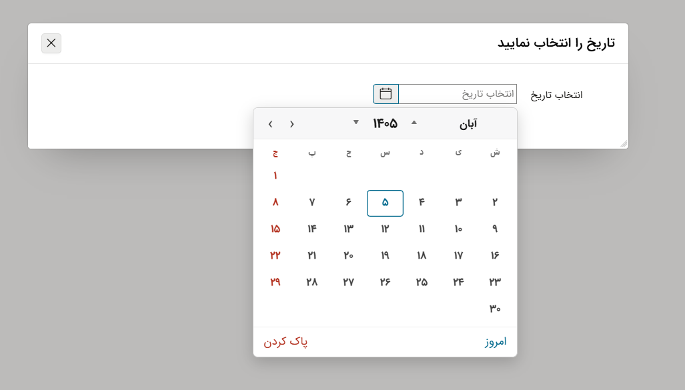

# 📅 پلاگین تقویم جلالی Oracle APEX | Persian Date Picker
<p align="center"></p>


> یک انتخابگر تاریخ (Date Picker) جلالی و شاهنشاهی حرفه‌ای، بومی‌سازی شده و کاملاً هماهنگ با رابط کاربری Oracle APEX.

**نویسنده:** [مجتبی حاجی علیقلی](https://apex360.ir) (Apex360)

**وب‌سایت مرجع:** [apex360.ir](https://apex360.ir/oracle-apex-jalali-calendar-plugin-persian-date-picker/)

**سازگاری:** Oracle APEX 24.1 و بالاتر

---

## 📖 درباره پلاگین

اگر با Oracle APEX کار کرده باشید، احتمالاً می‌دانید که پیاده‌سازی یک تقویم جلالی با امکانات مناسب و ظاهر هماهنگ با محیط APEX، همیشه هم ساده نیست. 

من این پلاگین را با هدف **ساده‌تر کردن کار توسعه‌دهندگان** و ارائه یک Date Picker جلالی با امکانات کاربردی طراحی کرده‌ام. تلاش کرده‌ام علاوه بر امکانات معمول انتخاب تاریخ، مشکلاتی مانند نمایش تقویم در صفحات Modal را نیز برطرف کنم تا استفاده از آن در پروژه‌های واقعی راحت‌تر باشد.
<p align="center"></p>
---

## ✨ امکانات و ویژگی‌های کلیدی

این پلاگین فراتر از یک انتخابگر تاریخ ساده است و امکانات زیر را در اختیار شما قرار می‌دهد:

*   **۱. نمایش تقویم خارج از محدوده Modal:** یکی از مشکلات رایج هنگام استفاده از Date Picker در صفحات Modal اوراکل APEX، محدود شدن فضا و نمایش داده نشدن بخشی از تقویم است. برای حل این مشکل، مکانیزمی مبتنی بر ساختار `iframe` پیاده‌سازی شده تا تقویم بتواند خارج از محدوده Modal نمایش داده شود.
*   **۲. ظاهر هماهنگ با Oracle APEX:** ظاهر این پلاگین با الهام از Date Picker بومی Oracle APEX طراحی شده است تا در کنار سایر آیتم‌های فرم، هماهنگی مناسبی داشته باشد و کاربر احساس تفاوت زیادی با محیط اصلی APEX نکند.
*   **۳. پشتیبانی از تقویم جلالی و شاهنشاهی:** امکان استفاده از دو نوع تقویم جلالی و شاهنشاهی در نظر گرفته شده است تا کاربران بتوانند متناسب با نیاز خود، تقویم موردنظرشان را انتخاب کنند.
*   **۴. انتخاب بازه تاریخ (Date Range):** علاوه بر انتخاب یک تاریخ، امکان انتخاب بازه تاریخ نیز وجود دارد. این قابلیت برای فرم‌های جست‌وجو، گزارش‌های دوره‌ای و سامانه‌هایی که با تاریخ شروع و پایان سروکار دارند، کاربرد زیادی دارد.
*   **۵. غیرفعال کردن انتخاب تعطیلات:** در بعضی از سامانه‌ها، انتخاب روزهای تعطیل مجاز نیست. در این پلاگین امکان غیرفعال‌کردن انتخاب تعطیلات در نظر گرفته شده است تا بتوان از آن در فرایندهای سازمانی و فرم‌های مختلف استفاده کرد.
*   **۶. محدودکردن انتخاب تاریخ بر اساس ماه و سال:** گاهی لازم است کاربر فقط بتواند تاریخ‌های مشخصی را انتخاب کند. این پلاگین امکان اعمال محدودیت بر اساس ماه و سال را فراهم می‌کند تا محدوده انتخاب تاریخ با نیاز پروژه هماهنگ باشد.
*   **۷. قابلیت انتخاب ساعت به همراه تاریخ:** برای اینکه بتوان از پلاگین در پروژه‌های مختلف استفاده کرد، گاهی نیاز به انتخاب ساعت در کنار تاریخ است که این قابلیت نیز فراهم شده است.


---

## 🚀 راهنمای نصب و پیکربندی

### پیش‌نیازها و تنظیمات مهم Session
برای استفاده بدون مشکل از این پلاگین، نیاز دارید تا در اپلیکیشن مربوطه تنظیمات `NLS_CALENDAR=PERSIAN` و فرمت درست `NLS_DATE_FORMAT` را تنظیم نمایید. 

چون پیش‌فرض این تنظیم در پایگاه داده Oracle متفاوت است، برای اینکه این تنظیمات را خود برنامه اعمال کند، کافی است به مسیر زیر در اپلیکیشن مربوطه بروید:

1. به مسیر **Shared Components -> Security Attributes** بروید.
2. در بخش **Database Session**، روی **Edit Security Attributes** کلیک کنید.
3. تنظیمات بخش **Initialization PL/SQL Code** را به صورت زیر تنظیم نمایید:

```sql
BEGIN
  EXECUTE immediate 'ALTER SESSION SET NLS_CALENDAR=PERSIAN';
  EXECUTE immediate 'ALTER SESSION SET NLS_DATE_FORMAT=''YYYY/MM/DD''';
END;
